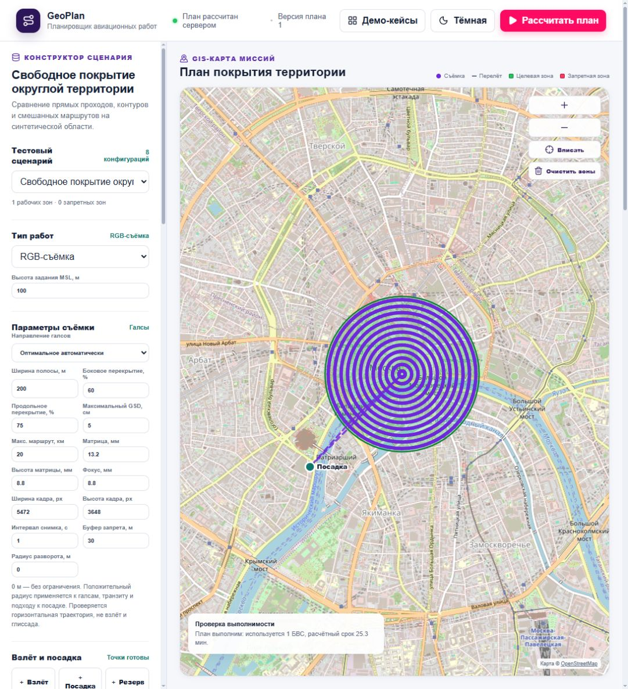

# Итог сессии и передача разработки

Обновлено: 18 октября 2026 года. Репозиторий: `git@github.com:aidiors/Geoscan.git`.
Рабочая ветка: `dev/architecture-refactor`, опубликованная база: `5f0ea4b`.
Последующие исправления и незавершённое сравнение продакшен-профилей включены
в эту передачу. Начинать с [актуального состояния многополигонного pipeline](production-handoff-2026-10-18.md):
там ограничения, частичные измерения и порядок продолжения.
Для продолжения разработки клонировать ветку `dev/architecture-refactor`
по инструкции ниже.
Автор Git настроен как `aidiors <78207095+aidiors@users.noreply.github.com>`;
при создании коммита использовать эту конфигурацию автора.

Текущие исправления и повторные измерения 18 октября — в
[отчёте проверки](review-2026-10-18.md). Настройка OR-Tools включена в команды
установки ниже; результаты от 17 октября сохранены как предыдущая приёмка.

## Принятые решения

- Приоритет — полезная съёмка и минимальные подлёт, соединения и возврат.
  Галсы не обязательны. Развороты остаются возможностью, но не главным критерием.
- Сравнивать методы только при одинаковых камере, высоте, перекрытии и ресурсе.
  75% продольного / 60% бокового — настройки, не подтверждённое требование
  организаторов. Записи Q&A содержат минимум 50% бокового.
- Площадь пересечения соседних кадров не тождественна продольному перекрытию
  при поворотах. Добавленный нами попарный порог остаётся диагностикой.
- Алгоритмы приближённые. Лучший из проверенных вариантов не объявляется
  глобально оптимальным. Для сложных территорий исходный метод часто лучше.

## Что реализовано

1. Общая физическая модель `geoplan.routing`: безопасные соединения, ветер,
   съёмочная скорость, отдельные старт/посадка, клетки и ресурсный Split.
2. Пул групп вылетов проходит штатное построение миссий, назначение,
   расписание и аудит. Итоговая цель применяется после расписания.
3. В основной `POST /v1/plans` добавлен ограниченный пул свободных контуров,
   контурных слоёв с прямым центром и разомкнутых дуг к посадке. Используется
   существующий `productive_routing`; интерфейс включает его по умолчанию.
4. Свободный кандидат не ухудшает суммарные налёт, camera-off, подлёт и возврат
   относительно проверенного исходного плана и лучшего пула фиксированных
   проходов. После этого сравнивается исходная целевая функция.
5. Кадры вставлены как явные точки реального маршрута. Часы не сбрасываются
   на каждом ребре или коротком транзите. Число кадров согласовано с
   `photo_capture_route_indices`; экспорт использует реальные позиции.
6. Аудит свободного покрытия проверяет ≥99,99% объединения конечных снимков,
   ≥99,9% внутреннего покрытия эффективным шагом, GSD, аппаратный интервал,
   физические времена и непрерывность. Остальные проверки — штатные.
7. GeoJSON/KML сохраняют позиции кадров, QGroundControl/Mission Planner —
   одиночные MAVLink-команды 2000 с последовательными идентификаторами.
   Средний дистанционный триггер для явных кадров не применяется.
8. Исправлен дешёвый порядок ранжирования: финальный перелёт считается
   к реальной посадке, а не всегда к старту. Согласованы времена расписания,
   аудита и экспортов; камера выключена на транзите между проходами.
9. Удалены дубли экспериментальных реализаций и старые драйверы. Стенд
   использует рабочие модули; приложение не импортирует стенд. Новые запуски
   не требуют локальных архивов. Команды и текущие документы обновлены.

Одиночные снимки используют
[MAVLink IMAGE_START_CAPTURE](https://mavlink.io/en/messages/common.html#MAV_CMD_IMAGE_START_CAPTURE):
один снимок на команду и последовательный capture ID. Поддержку этого
задания конкретным автопилотом/камерой нужно подтвердить на целевом аппарате.

## Границы текущего переноса

Свободный кандидат снимает всю область одним вылетом: одна RGB-область MSL
без рельефа, радиус 0, площадь до 5 км², не более 128 вершин и шаг от 10 м.
Четыре прохода поиска сохраняют префикс из шести путей и расширяют пул
до 18 на сочетание. В каждом проходе — до трёх сочетаний аппарат/площадки
и двух допустимых альтернатив до расписания, с отдельным мягким бюджетом
12 с между сочетаниями. Жёсткого ограничения полной задержки нет.

Другие нагрузки, AGL, крупные/несколько областей, ручные маршруты и радиус >0
используют обычное покрытие и проверенные группы вылетов. Это действующие
методы для иных условий, а не совместимые обёртки старой реализации.
Локальный ретайминг кадров остаётся исследованием: в приложение он не переносился.

Полосы эффективного шага — приближение бокового качества, не полноценная
фотограмметрия. Не моделируются сеть общих наблюдений, реальная реконструкция
и динамика камеры/аппарата. Прохождение программного аудита не подтверждает
готовность реального БВС к выполнению миссии.

## Проверенные результаты

Геометрический v6: 456 маршрутов на шести новых синтетических геометриях,
два интервала камеры. 318 прошли фильтр; 490 траекторий, включая точный
повтор, воспроизведены по архивным исходникам. Это результаты до переноса
в рабочий pipeline, с отдельным стендовым baseline.

Сквозная проверка текущего HTTP: шесть задач, 12 построенных планов,
24 HTTP-экспорта; все аудиты прошли. При камере 1 с и профиле 60/75:

| Территория | Без пула, мин | С пулом, мин | Выбранный метод |
|---|---:|---:|---|
| Круг, одна площадка | 20,89 | 19,72 | Контуры |
| Эллипс, одна площадка | 14,96 | 14,96 | Фиксированные проходы |
| Круг, разные площадки | 19,80 | 19,66 | Разомкнутые слои |
| Эллипс, разные площадки | 14,08 | 14,08 | Исходный |
| U-образная область | 14,68 | 14,68 | Исходный |
| Узкая перемычка | 17,27 | 14,89 | Ресурсный каталог |

На эллипсе рабочий исходный план сильнее стендового (14,08 против 14,90),
поэтому новый стендовый вариант 14,52 не принимается. На круге выбранные
явные кадры и консервативная скорость дают 19,72, а не стендовые 19,70.
Эти две серии не подменяют друг друга.

Включены в репозиторий:

- [входы v6](../reference/benchmarks/coverage-v6-inputs.json);
- [компактные исторические метрики](../reference/benchmarks/coverage-v6-summary.json);
- [проверка рабочего pipeline](../reference/benchmarks/pipeline-acceptance.json);
- фабрики `backend/scenarios/freeform.py`, рабочие алгоритмы, тесты и драйверы.

Большие локальные снимки и промежуточные серии в `docs/benchmark-results/`
игнорируются Git. Для разработки, тестов и нового расчёта они не нужны.

## Подготовка после клонирования

После публикации изменений в рабочей ветке:

```powershell
git clone --branch dev/architecture-refactor git@github.com:aidiors/Geoscan.git
cd Geoscan
npm ci
npm run build
uv sync --directory backend --locked --extra optimization
uv run --directory backend --extra optimization uvicorn geoplan.bootstrap:app --host 127.0.0.1 --port 8001
```

Открыть `http://127.0.0.1:8001/`. Требуются Python 3.14 и `uv`, Node.js ≥22.20.
Python закреплён в `backend/.python-version` и `pyproject.toml`; оба lock-файла
включены в Git. Локально используется Node 24.15, CI/сборка Docker — Node 22.20.
Для разработки используйте `uv sync --extra optimization`, без `--no-dev`.
Секретов, внешней БД или локальных данных предыдущего разработчика не требуется.
Интернет нужен при установке зависимостей и загрузке фоновых OSM-тайлов.

`reference/materials/*.exe` и `*.pptx` хранятся через Git LFS. Они не нужны
для сборки или тестов; для самих материалов при необходимости выполнить
`git lfs install` и `git lfs pull`. Не переносить чужие SSH-ключи, `.venv`,
`node_modules` или `dist`: окружения и сборка создаются указанными командами.

Альтернативный запуск:

```powershell
$env:GEOPLAN_PORT=8001
docker compose up --build -d
```

В интерфейсе открыть «Демо-кейсы» → «Свободное покрытие: ближе к посадке».
Включить оптимизацию вылетов, выключить быстрый режим, радиус оставить 0.
Карточка «Свободное покрытие» появляется, когда новый метод действительно выбран.

## Проверки и воспроизведение

Из корня:

```powershell
uv run --directory backend --extra optimization ruff format --check src tests benchmarks scenarios ../scripts
uv run --directory backend --extra optimization ruff check src tests benchmarks scenarios ../scripts
uv run --directory backend --extra optimization ty check src tests benchmarks scenarios ../scripts
uv run --directory backend --extra optimization python ../scripts/check_architecture.py
uv run --directory backend --extra optimization python ../scripts/check_docs.py
uv run --directory backend --extra optimization pytest -q
npm run typecheck
npm run lint
npm run check:architecture
npm test
npm run build
```

Геометрия, снимок исходников и проверка маршрутов:

```powershell
uv run --directory backend --extra optimization python -m benchmarks.run_frame_coverage --suite holdout --profile 60:75 --output ../docs/benchmark-results/coverage-new
uv run --directory backend --extra optimization python benchmarks/verify_free_coverage.py ../docs/benchmark-results/coverage-new
uv run --directory backend --extra optimization python -m benchmarks.verify_freeform_pipeline --output ../docs/benchmark-results/pipeline-new.json
```

Выходные каталоги/файлы должны отсутствовать. Драйверы не затирают доказательства.
Для браузерного E2E: `npx playwright install chrome`, затем `npm run test:e2e`.
В этой Windows-среде политика администратора запрещает DevTools debugging
Chrome, поэтому браузерный E2E здесь не объявляется пройденным. Политика не
обходится; HTTP-интеграция, компоненты и сборка проверяются отдельно.

## Финальная проверка передачи

Подготовлен отдельный исходный снимок из файлов этой сессии,
без `.venv`, `node_modules`, `dist`, локальных результатов и настроек чата.
В нём заново выполнены `uv sync --locked` и `npm ci`:

- полный backend-набор: **342 passed**, 5 предупреждений Rasterio;
- frontend: **35 passed**, typecheck, lint, архитектура и build;
- Ruff format/lint, ty, архитектура Python, локальные ссылки документации;
- бенчмарк из включённых в репозиторий замороженных входов: **34 маршрута**,
  проверка метрик, выбора и исходных SHA-256 прошла;
- после проверки последовательных capture ID для нескольких вылетов
  повторно пройдены 16 проверок времени, кадров, аудита и экспортов.

Это проверка чистого дерева исходников через отдельный снимок.
В состав изменений входят `backend/scenarios/freeform.py`, новые
модули `geoplan.routing`, тесты и `reference/benchmarks/`.

Docker собран из рабочего пакета без `benchmarks`/`scenarios`. Приложение
на `http://127.0.0.1:8001/` проверено через встроенный браузер: в демо
«Свободное покрытие: ближе к посадке» выбран контурный маршрут,
**28,5 → 25,3 мин** и **5,1 → 2,0 мин camera-off**, аудит пройден.
Это демонстрационный парк со скоростью 70 км/ч и другим исходным разбиением,
поэтому значения отличаются от таблицы HTTP-контроля 90 км/ч выше.
Chrome E2E не объявляется пройденным из-за ранее указанной политики системы.



## Следующие задачи

1. Многовылетное/многокомпонентное свободное покрытие и адаптивная декомпозиция.
   Сохранить назначение, повторные вылеты, ресурс, реальные окна и аудит.
2. Проверка реальной фотограмметрии: ориентации кадров, общие наблюдения,
   связность и избыточность; уточнение камеры и минимальной воздушной скорости.
3. Устойчивость к новым реальным областям, смещению площадок и ветру.
4. Общий бюджет времени включая кадры, scheduler и аудит. Замерять полный HTTP,
   а не только генерацию; типовые текущие проверки занимают примерно 3–8 с.
5. Подтверждение одиночных capture-команд целевым аппаратным стеком.

Не возобновлять удалённые старые драйверы и не вводить параллельную копию
алгоритмов в `benchmarks`. Основные места работы —
[архитектура](architecture/README.md#свободное-покрытие) и
[актуальный план](productive-routing-plan.md).

## Состояние Git

Предыдущая интеграция опубликована коммитом `f564beb`:
`feat: integrate audited UAV routing and coverage optimization`.

Затем получены три коммита до `5f0ea4b`. Последующие исправления камеры,
диагностики, стенда и ускорение назначения ещё не закоммичены и не отправлены.
После их публикации сокоманднику достаточно получить указанную рабочую ветку.
